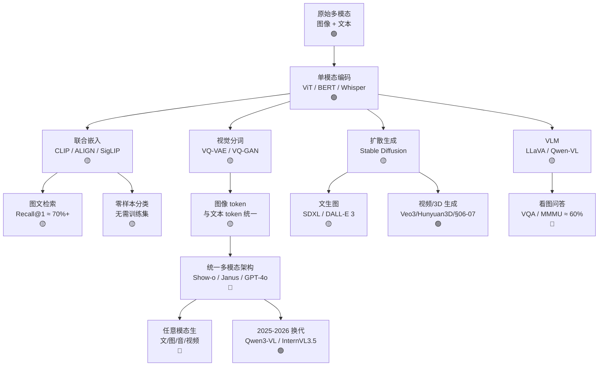

# Ch10 多模态学习 · 一页信息图

> **一句话总纲**: 多模态=把图像/文本/音频/视频等不同模态编码到共享嵌入空间,Ch10 教 5 个核心 — 表征对齐 (CLIP/SigLIP) + VLM (LLaVA/Qwen3-VL/InternVL3.5) + 视觉视频分词 (VQ-VAE/VQ-GAN) + 跨模态生成 (扩散/流匹配) + 统一架构 (GPT-4o/Gemini/Qwen3-Omni),并在 §06/§07 延伸到 2025-2026 的图像/视频/3D 生成前沿。是 GPT-4V / 豆包 / 智谱清言背后的技术栈。

---

## 一 · 知识拓扑图 (Mermaid 8-15 节点, 🟢/🟡/🔴 色标)

---

## 二 · 核心公式速查表 (≥10 条, 每条配数字例 ≤3 步)

| # | 公式 | 数字例 | 约束/陷阱 |
|---|---|---|---|
| F1 | **早期融合** $x_{\text{fused}} = [x_{\text{img}}; x_{\text{txt}}] \in \mathbb{R}^{d_1+d_2}$ | ViT dim=768 + BERT dim=768 → 1536 维 | 维度对齐,需要投影层 |
| F2 | **晚期融合** $\hat{y} = \alpha \hat{y}_1 + (1-\alpha)\hat{y}_2$ | α=0.5 等权融合 | 单模态强时 α≠0.5 更好 |
| F3 | **跨模态注意力** $\text{Attn}(Q_v, K_t) = \text{softmax}(Q_v K_t^\top / \sqrt{d_k})$ | Q-Former 用 32 个学习 query | 视觉 Q 与文本 K 维度同 |
| F4 | **InfoNCE 对比损失** $L = -\log \frac{\exp(\text{sim}(z_i, z_i^+)/\tau)}{\sum_{j=1}^N \exp(\text{sim}(z_i, z_j)/\tau)}$ | CLIP 大 batch,τ=0.07 | 负样本越多下界越紧 |
| F5 | **CLIP 零样本精度** $\text{Acc} = \frac{1}{N}\sum_i \mathbb{1}[\arg\max \text{sim}(z_i^{\text{img}}, z_j^{\text{txt}}) = i]$ | ViT-L/14 ImageNet zero-shot ≈ 75.5% | prompt 工程可提升 5+ 点 |
| F6 | **VQ-VAE 量化** $z_q = \arg\min_{z_k \in \mathcal{C}} \|z_e - z_k\|_2$ | codebook size = 8192 | codebook collapse 风险 |
| F7 | **VQ-GAN 损失** $L = \|x - \hat{x}\|_1 + \lambda \|\text{D}(x) - \text{D}(\hat{x})\|_1 + \|sg[z_e] - z_q\|_2^2$ | patch size = 16×16 | 重建 + 感知 + 量化三重 |
| F8 | **扩散跨模态** $L = \mathbb{E}_{t,\epsilon,x,c}[\|\epsilon - \epsilon_\theta(x_t, t, c)\|^2]$ | 1000 时间步,UNet/DiT | $c$ = CLIP/T5 文本嵌入 |
| F9 | **无分类器引导** $\hat\epsilon=(1+w)\epsilon_c-w\epsilon_\varnothing$ | 典型 w≈7.5 | w↑对齐↑多样性↓ |
| F10 | **VQA 准确率** $\text{Acc} = \mathbb{1}[\arg\max P(a\|v, q) = a^*]$ | VQAv2 闭集人类 ≈ 80%+ | 闭集 vs 开集差距大 |
| F11 | **VQ-VAE 重建率** $\text{PSNR} = 10 \log_{10} \frac{255^2}{\text{MSE}}$ | ImageNet 256×256 ≈ 22-25 dB | 下游任务需要 ≥ 20 |
| F12 | **流匹配目标** 学向量场 $v_\theta$ 把噪声直推到数据 | Wan/LTX 视频模型用 | 少步 (5-20) 采样 |
| F13 | **3D 前馈重建** 单网络回归 3DGS/mesh, 免逐场景优化 | TripoSR 秒级出模型 | 拓扑弱于扩散路线 |
| F14 | **MMMU 多模态基准** 30 学科图文问答 | GPT-4o ≈ 69% (2024),人类 ≈ 88% | 大学级推理 |
| F15 | **2026 VLM 双雄** 开源 VLM 换代 | Qwen3-VL 2B→235B-A22B;InternVL3.5 241B-A28B | Thinking 版/视觉智能体/256K 上下文 |

---

## 三 · 关键流程 (3-5 步流程卡, 数字嵌入)

### CLIP 训练流程 (≈5 步)

1. **大 batch 图文对** 组成正负样本;正样本 N 对(对角线),负样本 N²-N
2. **编码**:图像 → ViT-L/14;文本 → 12 层 Transformer
3. **投影**:各自经线性投影到共享 512/768 维(已 L2 归一化)
4. **相似度矩阵**: $N \times N$ 的余弦相似度 → 双向 softmax,对角线为正例
5. **更新**:对称 InfoNCE 梯度回传双编码器,温度 τ=0.07 与权重一起学

### 视觉分词 (VQ-VAE) 流程 (≈4 步)

1. **编码器** ViT-detector 把图像 $x$ 编码为连续 $z_e$
2. **量化** 在 codebook $\mathcal{C}$(size=8192)中找最近邻得到 $z_q$
3. **解码器** 把 $z_q$ 还原图像 $\hat{x}$,训练时 $z_e$ 直传(直通估计器绕过梯度)
4. **判别器** PatchGAN 判断 $\hat{x}$ 真实度 → 对抗损失

---

## 四 · 真题 / 面试题索引 (12 道)

| # | 题面 | 章节 | 难度 |
|---|---|---|---|
| Q1 | CLIP 怎么训练?文本图像配对数据集多大? | §01 | ★★ |
| Q2 | InfoNCE 损失为何能学到通用表征? | §01 | ★★★ |
| Q3 | 早期融合 vs 晚期融合 tradeoff? | §01 | ★★ |
| Q4 | 为什么 VLM 多用 Q-Former 或投影层而非 early fusion? | §02 | ★★★ |
| Q5 | VQ-VAE 如何做图像分词?codebook collapse 怎么防? | §03 | ★★★ |
| Q6 | 视觉自回归 (VAR) 与 LLM 有何相通? | §03 | ★★ |
| Q7 | Stable Diffusion 怎么把文本注入到 UNet? | §04 | ★★★ |
| Q8 | DALL-E 3 vs Stable Diffusion 关键差异? | §04 | ★★ |
| Q9 | 统一多模态架构 Show-o 用什么 token 表征? | §05 | ★★★ |
| Q10 | GPT-4o 怎么做到实时语音对话?延迟压到多少? | §05 | ★★★ |
| Q11 | 2025-2026 开源 VLM 双雄换代到哪一代? Thinking 版新在哪? | §02 | ★★★ |
| Q12 | Sora 2 为什么 2026 年停运?3D 生成三条路线解决什么? | §06/§07 | ★★ |

---

## 五 · 与上下章的连接 (5 个跨章桥)

1. **Ch06 §03 视觉 Transformer** → Ch10 §01 ViT 作 CLIP 的图像编码器
2. **Ch07 §04 Transformer 与注意力** → Ch10 §02 跨模态注意力机制
3. **Ch08 §03 目标检测** → Ch10 §03 图像分词与检测 token 化
4. **Ch09 §02 ASR** → Ch10 §05 语音-文本联合模型 (SpeechGPT/SLIDE)
5. **Ch11 §03 视觉-语言-动作** → Ch10 §05 VLM 拓展为 VLA (如 RT-2)

---

## 六 · 一段话总结 (60 秒讲完 Ch10)

多模态学习 (multimodal learning) 是把不同模态 (vision, language, audio, video) 的数据投影到共享语义空间,然后用一个统一模型做理解、检索、生成。本章 7 节从 (1) 表征对齐 (CLIP/SigLIP 通过 InfoNCE 在数亿图文对上对比学习) 到 (2) 视觉语言模型 (VLM, 用投影层/Q-Former 把 ViT 的视觉 token 接到 LLM; 2025-2026 换代到 Qwen3-VL、InternVL3.5, Thinking 版做视觉推理) 到 (3) 视觉视频分词 (VQ-VAE/VQ-GAN 把图像变离散 token) 到 (4) 跨模态生成 (Stable Diffusion 在潜空间扩散; CFG 用文本引导去噪; Wan 用流匹配) 到 (5) 统一架构 (GPT-4o/Gemini/Qwen3-Omni 单 transformer 处理任意模态) 再到 (6)(7) 2025-2026 的图像/视频/3D 生成前沿 (Nano Banana 2.1/FLUX 3 (FLUX.2 为历史条目)/Kling 4.0/Veo 3/MiniMax H3/TripoSR/Hunyuan3D; Sora 2 已停运, World Labs 已并入 AMD)。评测看 MMMU (GPT-4o ≈69%)、检索 Recall@K 与多模态幻觉。**核心心智模型**:把模态看作"语言",对齐看作"翻译成共享词表",生成就是条件语言模型;具体型号是快照,方法是本体。

---

## 7. 数据/资源附录

- CLIP 论文: Radford et al., "Learning Transferable Visual Models From Natural Language Supervision", ICML 2021
- ALIGN: Jia et al., Google, 2021 (1.8B noisy pairs)
- SigLIP: sigmoid 损失, 不需 softmax 大 batch, Google 2023
- LLaVA: Liu et al., "Visual Instruction Tuning", NeurIPS 2023
- Qwen-VL: 阿里达摩院, 2023
- BLIP-2: Li et al., Salesforce, Q-Former 架构
- VQ-VAE: van den Oord 2017; VQ-GAN: Esser 2021
- Stable Diffusion: Rombach et al., CVPR 2022
- DALL-E 3: OpenAI, 2023, 文本重写 pipeline
- Show-o: 字节跳动 + 浙大, 2024, 统一自回归+扩散
- Janus: DeepSeek, 2024, 解耦视觉编码
- GPT-4o: OpenAI, 2024, 实时全模态
- Gemini 1.5: Google, 2024, 10M 上下文多模态
- Qwen3-Omni: 阿里, 2025-09, Thinker-Talker MoE 全模态开源
- Qwen2.5-VL / Qwen3-VL: 阿里, 2025-01 / 2025-09 起, Thinking 版 + 视觉智能体, 2B→235B-A22B
- InternVL3 / InternVL3.5: 上海 AI Lab, 2025-04 / 2025-08, 241B-A28B MoE
- Veo 3: Google, 2025, 音画一体视频生成; FLUX.2: BFL, 2025-11 (历史条目, 已被 FLUX 3 取代); Nano Banana Pro: Google, 2025-11
- FLUX 3: BFL, 2026-07 起全系落地 (Image Klein 5.6B 开源权重 2026-10-15, 盲评第一; 另含 FLUX.3 文生视频/Video/Action); Kling 4.0: 快手, 2026-10, 30 秒原生 4K 10-bit HDR 双声道立体声; Nano Banana 2.1 (2026-10) / Qwen-Image-2.0 (2026-02) / Runway Gen-4.5; World Labs 2026-09-28 并入 AMD
- MiniMax H3: 2026-08 开源, 原生立体声音视频联合生成; Sora 2: 2025-09 发布, 2026-04 停运
- TripoSR (Stability×Tripo, 2024) / Hunyuan3D 2.1 (腾讯, Apache-2.0) / TRELLIS (微软, 2024-12): 3D 生成三路线
- 基准: MMMU, MMBench, MMHal-Bench, MathVista, ChartQA, DocVQA, GenEval, DPG-Bench
